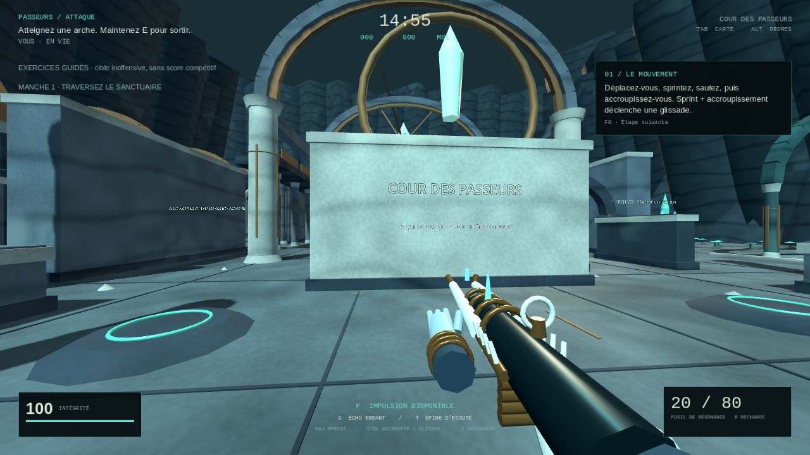

# SONAR: Echoes of the Hollow

Un FPS tactique d'extraction où le son devient une information, une menace et un mensonge. Les Passeurs cherchent une issue dans un sanctuaire souterrain ; les Veilleurs en protègent les seuils. Un adversaire silencieux peut disparaître. Courir, tirer ou utiliser un ping révèle une présence.

**Version 0.1.0 — alpha de production jouable, hors ligne.** Ce dépôt met en œuvre un premier jalon du [cahier des charges intégral](docs/CAHIER_DES_CHARGES.md). Il ne constitue pas encore sa réalisation finale. [État réel et prochaines étapes](docs/PRODUCTION_STATUS.md) · [Couverture des exigences](docs/FEATURE_MATRIX.md) · [Rapport de tests](docs/TEST_REPORT.md).



## Jouer

Téléchargez l'archive de votre plateforme depuis les [Releases](https://github.com/redairaqi08/game/releases). Décompressez tous les fichiers avant de lancer `sonar.exe` sous Windows ou `sonar.x86_64` sous Linux. Aucun compte ni connexion réseau n'est nécessaire. Sur Linux, si nécessaire : `chmod +x sonar.x86_64`.

Pour lancer les sources, installez **Godot 4.6.3 Standard** puis importez `project.godot` dans l'éditeur et appuyez sur **F5**. Avec la ligne de commande :

```bash
git clone https://github.com/redairaqi08/game.git
cd game
godot --editor --path .
# Ou jouer directement après l'import :
godot --path .
```

Choisissez d'abord **Apprendre → Tutoriel**. La cible y est inoffensive, les huit étapes présentent les véritables systèmes de déplacement, ping, combat, diversion, piège et extraction. Le menu propose aussi des manches de duel, 2v2 ou 3v3 contre des bots, attaque/défense seules, entraînement et simulation.

## Commandes

| Action | Par défaut |
| --- | --- |
| Déplacement | ZQSD, ou WASD dans les paramètres |
| Regarder / tirer / viser | Souris / clic gauche / clic droit |
| Sprint / saut / accroupissement | Maj / Espace / Ctrl ou C |
| Glissade | Accroupissement pendant le sprint |
| Franchissement bas | Espace près d'un obstacle franchissable |
| Recharge / armes | R / 1 et 2 |
| Ping symétrique | F |
| Gadgets | Maintenir G ou T pour prévisualiser ; relâcher pour poser/lancer |
| Extraction | Maintenir E dans le cercle d'une arche |
| Carte / ordres d'équipe | Tab / Alt |
| Pause / changer d'allié observé | Échap / Espace après élimination ou extraction |
| Diagnostic | F3 ; F8 termine la manche en diagnostic |

Les actions clavier sont remappables. Sensibilité, champ de vision, mouvements de caméra, volume, contraste des silhouettes, intensité des ondes et qualité graphique sont sauvegardés localement.

## Ce qui est jouable

- Une vie par manche, 4 ou 6 manches avec rôles alternés. Chaque Passeur extrait rapporte 100 points à son équipe ; chaque Passeur arrêté rapporte 100 points à la défense.
- Perception acoustique individuelle avec incertitude, mémoire, confiance, occlusion, perte du contact et partage estimé entre alliés. Le ping détecte aussi une cible immobile ; un mur opaque bloque la reconstruction exacte.
- Contrôleur commun humain/bots, fusil de résonance et pistolet, visée, recul, recharge, dégâts corporels et tête.
- Six gadgets destructibles : Écho errant, Voile muet, Épine d'écoute, Oreille de pierre, Cloche brisée, Chœur de cristal.
- Sanctuaire à neuf zones, trois routes et trois sorties, avec variantes plus compactes en 1v1 et 2v2 ; personnages, armes et architecture procéduraux originaux.
- Bots avec réactions bornées, enquêtes sur de faux signaux, recherche/abandon, navigation A*, répartition des sorties, interception d'alertes et ordres d'équipe.
- Audio spatial original, menus français, carte sans positions ennemies secrètes et observation alliée.

Les passerelles supérieures restent décoratives. L'acoustique utilise des rayons et une atténuation approximée. Les animations sont procédurales ; le rythme, la précision des bots, le mixage et l'équilibre des sorties demandent encore des tests humains. Le réseau est hors périmètre de cette version.

## Vérifier et exporter

```bash
# Godot, Bash et ripgrep sont nécessaires pour le vérificateur :
tools/check.sh
# Une partie bot contre bot reproductible, accélérée en headless :
godot --headless --path . --fixed-fps 60 -- \
  --simulate --seed=27013 --team-size=3 --rounds=4 --duration=90 \
  --report=/tmp/sonar-simulation.json
# Installer seulement les templates desktop officiels, puis exporter :
python3 tools/install_export_templates.py
mkdir -p builds/linux builds/windows
godot --headless --path . --export-release 'Linux x86_64'
godot --headless --path . --export-release 'Windows x86_64'
```

Les exports Linux et Windows sont préconfigurés. L'exécutable Windows doit être vérifié sur une vraie machine Windows. Le workflow GitHub Actions importe le projet, exécute les régressions et produit les archives de build. Les valeurs d'équilibrage se trouvent dans `config/balance.json`. Les sons sont déjà inclus ; leur régénération facultative utilise uniquement `python3 tools/generate_audio.py`.

## Architecture et documentation

`game.gd` arbitre le match ; `actor.gd` applique les commandes ; `acoustics.gd` transforme les événements en connaissances individuelles ; `bot.gd` décide à partir de ces connaissances ; `navigation.gd` calcule les routes ; `gadgets.gd`, `level.gd`, `ui.gd` et `audio.gd` présentent leurs systèmes respectifs. Aucun moteur externe ou paquet de scripts n'est requis.

[Design](docs/GAME_DESIGN.md) · [Lore](docs/LORE.md) · [Niveau](docs/LEVEL_DESIGN.md) · [IA](docs/AI_DESIGN.md) · [Acoustique](docs/ACOUSTICS.md) · [Art](docs/ART_DIRECTION.md) · [Audio](docs/AUDIO_DESIGN.md) · [Interface](docs/UI_DESIGN.md) · [Licences](docs/LICENSES.md).

Si le jeu semble sombre ou lent, choisissez le profil **Économie** dans les paramètres et réduisez la résolution de la fenêtre. Un ennemi immobile invisible est une règle du jeu : utilisez F et vérifiez votre ligne de vue. Si Godot ne peut pas écrire ses données dans un environnement isolé, définissez `XDG_DATA_HOME`, `XDG_CONFIG_HOME` et `XDG_CACHE_HOME` vers des dossiers accessibles. Les réglages sont dans `user://profile.json` (accessible via l'éditeur Godot : Projet → Ouvrir le dossier des données utilisateur).

Code, géométrie et sons originaux sous MIT ; polices sous leurs licences incluses. Mentions Godot conservées dans la distribution.
